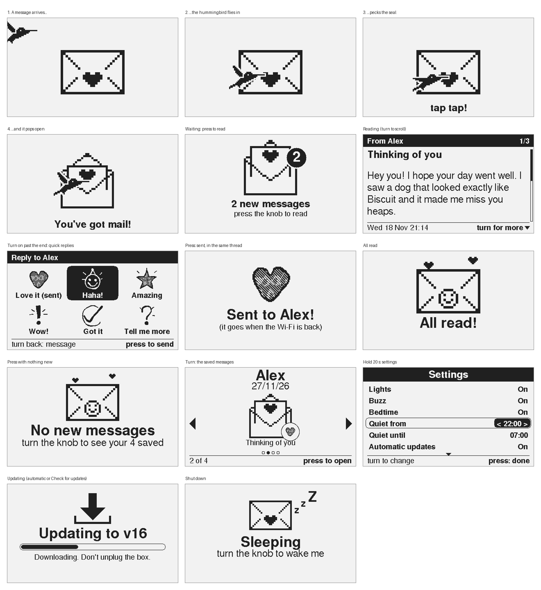

# MessageBox

A small box for messages from a friend or partner. They send an email to a private Gmail
address, and the box shows it on an e-paper screen with a spinning LED ring and a haptic buzz.



## How it behaves

| | Screen | LED ring | Vibration |
|---|---|---|---|
| **Waiting** | Blank (the panel sleeps) | Off (or a `!led` glow) | |
| **New message** | Pixel envelope with a heart; the badge shows how many are new | Spins in circles: style, colours and speed are settings | tick tick tick tick tick **TICK**, each tick longer and stronger |
| **Press the knob** | The oldest new message. **Clockwise scrolls down, anticlockwise up.** | Soft glow | A tick for every click; a double bump at the top or bottom |
| **Press again** | "Keep this message?" **Anticlockwise = DELETE, clockwise = SAVE** | Pulses red (delete) or blue (keep) | Tick |
| **Press to confirm** | The next new message | | Saved: soft double beat. Deleted: one thud. |
| **All read** | Happy envelope, then blank | Rainbow, then goes out LED by LED | A fading brrr-rr-r, like powering down |

- **Saved messages:** press the knob while the screen is blank (with nothing new) to look
  through them, keeping or deleting each one the same way.
- **Walking away:** if the knob isn't touched for 3 minutes while reading, the box goes back to
  the envelope, or powers down if nothing new is left.
- **Setup:** hold the knob for **5 s** (the ring fills up) to open the setup Wi-Fi.
- **Knob haptics:** every click and press gives a small tick. You can set its strength and
  length, or turn it off.
- **Storage:** messages are kept in the C3's flash (up to 40), so new and saved ones survive a
  power cut.

### Screen speed

The panel takes about **0.35 s** for a fast (partial) refresh and about **1 s** for a full one.
The firmware is built around that:

- **Drawing in the background:** drawing runs in its own task, so the LED ring, haptics and
  knob stay smooth while the panel updates.
- **Skipping frames:** if you turn the knob faster than the panel can keep up, the box skips
  straight to where you stopped instead of drawing every step.
- **Sending the picture:** the frame is kept in RAM and sent over SPI at the configured speed
  (1 MHz by default, with 4 and 10 MHz options).
- **Fast refresh for routine changes:** scrolling, changing pages, choosing keep or delete,
  and badge updates use the fast refresh.
- **Full refreshes:** initialization, clearing to blank, entering setup, testing the panel,
  changing rotation, and recovering from a BUSY timeout use a full refresh.
- **Saving power:** the driver switches the panel's high voltage off after every update.

## Parts

| Part | What it does |
|---|---|
| ESP32-C3 SuperMini | The brains: Wi-Fi, web page, Gmail |
| WeAct 3.7" e-paper, black/white, 240 × 416 (GDEY037T03) | Shows the message. Keeps the picture with no power. |
| WS2812B 12-LED ring | Spins in circles while there are new messages |
| EC11 / KY-040 rotary encoder with push button | Scroll, choose keep or delete, confirm; hold 5 s for setup |
| PWM coin vibration motor module (GND, VCC, IN) | Haptic ticks for the knob, and the new-message buzz |
| 330 Ω resistor, 470 µF capacitor (6.3 V or more) | Protect the LED ring |

## Wiring



| From | To | Note |
|---|---|---|
| E-paper **VCC** | C3 **3V3** | |
| E-paper **GND** | C3 **GND** | |
| E-paper **SCL** (clock) | **GPIO10** | |
| E-paper **SDA** (data) | **GPIO6** | |
| E-paper **CS** | **GPIO7** | |
| E-paper **D/C** | **GPIO5** | |
| E-paper **RES** | **GPIO8** | Tested. Optional: see [firmware/README.md](firmware/README.md) |
| E-paper **BUSY** | **GPIO4** | Tested. Optional: see [firmware/README.md](firmware/README.md) |
| Ring **5V** | C3 **5V** | 470 µF across the ring's 5V and GND (+ leg to 5V) |
| Ring **GND** | C3 **GND** | |
| Ring **IN** (DIN) | 330 Ω → **GPIO2** | Leave the ring's OUT unconnected |
| Encoder **+** (marked 5V) | C3 **3V3** | **Not 5V.** The module's pull-ups would put 5 V on the C3. |
| Encoder **GND** | C3 **GND** | |
| Encoder **CLK** (S1) | **GPIO0** | |
| Encoder **DT** (S2) | **GPIO1** | |
| Encoder **SW** (KEY) | **GPIO21** | |
| Vibration **VCC** | C3 **5V** | |
| Vibration **GND** | C3 **GND** | |
| Vibration **IN** | **GPIO20** | |

**Leave GPIO3 and GPIO9 unconnected** (the 5th pin from the USB end on each side). The case's
2 mm zip tie goes over those two pads, and GPIO9 is also the BOOT pin. Solder jumper wires
straight to the pins you use; there's no need for header pins.

Things to know:

- **Power:** everything runs from the C3's USB-C, so use a phone charger or computer port that
  gives 1 A. The ring's brightness is set to 60 of 255 by default. At full white, 12 LEDs draw
  about 0.7 A.
- **If the ring flickers or shows the wrong colours**, the C3's 3.3 V data signal may be too low
  for a ring running on 5 V. Feed the ring's 5V through a 1N4001 diode (stripe towards the ring).
  That gives the ring about 4.3 V, and 3.3 V then counts as "high".
- **GPIO2 is a "strapping" pin** that the C3 reads at power-up. It's fine for the LED ring's
  data line.
- The e-paper uses the C3's hardware SPI on GPIO10 (clock) and GPIO6 (data).
- **GPIO21 is also the C3's TX pin** and chatters while it boots. Don't hold the knob down while
  plugging the box in.
- On the encoder, if one click moves two messages, change the two `4`s in
  `MessageBox/EncoderCounter.h` (edges per click) to `2`.

## Build and flash

**Ready-made images** are in [`firmware/`](firmware/):

- **Over USB at 0x0:** flash `MessageBox-main-v11-USB-installer.bin` with Espressif's browser
  flasher (DIO, 40 MHz, 4 MB). This erases settings and messages.
- **From the device page's Firmware update:** paste the raw GitHub link to
  `MessageBox-main-v11-OTA.bin`. This keeps settings and messages.

[`firmware/README.md`](firmware/README.md) has the steps, a test checklist and the review of v9.

**Building it yourself:** Arduino-ESP32 **3.3.7**, GxEPD2 1.6.9, Adafruit GFX 1.13.0, Adafruit
BusIO 1.17.4 and Adafruit NeoPixel 1.15.5. The sketch has its own OTA partition table
(`partitions.csv`):

```sh
arduino-cli compile \
  --fqbn esp32:esp32:esp32c3:CDCOnBoot=cdc,PartitionScheme=custom,FlashSize=4M,FlashMode=dio,FlashFreq=40 \
  --build-property upload.maximum_size=1769472 \
  --output-dir output MessageBox
```

`output/MessageBox.ino.merged.bin` is the USB installer, and `output/MessageBox.ino.bin` is the
OTA image. The Serial Monitor runs at 115200.

## Test it (setup Wi-Fi)

On first start no Wi-Fi is saved, so the box opens its own:

1. The e-paper shows the setup steps and the ring turns blue.
2. On your phone, join **MessageBox-Setup** (password **messagebox**). The page usually pops up
   by itself. If it doesn't, open **http://192.168.4.1**.
3. Under **Test the hardware**, check each part:
   - [ ] **Encoder:** turn the knob and watch the dial move one step per click, clockwise
         counting up. If it runs backwards, tick *Reverse the knob*. Each click should give a
         small haptic tick.
   - [ ] **LED ring:** *Test each LED* lights each LED red, then green, then blue, in order.
   - [ ] **E-paper:** *Test pattern* shows a frame with all four edges, crossed lines and bars.
         *Envelope*, *Keep or delete* and *Happy envelope* show those screens.
   - [ ] **The whole flow:** *Send to the box* makes a pretend message:
     - The ring spins, the motor goes tick ... TICK, and the envelope shows "1".
     - Press: the message opens. Turn to scroll.
     - Press: "Keep this message?". Turn left or right, then press to confirm.
     - The happy envelope shows, then the box powers down.
4. Tune the **Lights** and **Haptics** with their *Try* buttons. They play the values in the
   boxes without saving, so you can adjust them until you like them, then press **Save
   settings**. Light, haptic and screen settings apply straight away, with no restart.

## Set up Gmail

Use a **new Gmail account just for the box**. Don't use your own. Messages sent to it are what
the box shows.

1. Create the account, then go to **myaccount.google.com → Security** and turn on **2-Step
   Verification**.
2. Go to **myaccount.google.com/apppasswords**, create an app password (name it
   "MessageBox"), and copy the 16 letters.
3. On the box's page, fill in:
   - **1. Home Wi-Fi:** use *Scan for networks*, pick yours and enter the password (2.4 GHz only).
   - **2. Gmail inbox:** enter the box's Gmail address and the app password.
     *Only show mail from* is a list of the addresses allowed to send messages, such as your
     friend's and yours. Leave it empty to show everything (spam included).
   - **Time zone:** the default is Sydney/Melbourne (`AEST-10AEDT,M10.1.0,M4.1.0/3`).
     Brisbane is `AEST-10`, Adelaide `ACST-9:30ACDT,M10.1.0,M4.1.0/3`, Perth `AWST-8`.
4. Press **Save settings**. The box restarts and joins your Wi-Fi. The setup Wi-Fi closes and
   the screen goes blank (waiting). The same page is now at **http://messagebox.local** from any
   phone or computer on your home Wi-Fi. If `.local` doesn't open, use the IP address shown in
   your router's device list or the Serial Monitor.
5. Send an email to the box's address. Within a minute (*Check every*, default 60 s) the box
   buzzes and shows it. You can also press **Check mail now**. The **Status** and **Log**
   boxes show what happened, for example `Login refused` if the app password is wrong.

If the home Wi-Fi can't be joined within 20 s, or drops for 30 s, the setup Wi-Fi opens again
on its own. The box keeps retrying the home Wi-Fi about every minute while the setup access
point has no clients and no scan is running.
**Hold the knob for 5 seconds**, until the ring fills up, to open the setup Wi-Fi by hand, for
example to change networks.

## Sending messages

Attach a JPEG or PNG to an email to show a picture on the box. The box converts the first
supported image to black and white and keeps it with the message. Turn the knob clockwise past
the last line of text to see it, and anticlockwise to return to the text. An email with only a
picture opens directly on it. Press the knob for the usual keep-or-delete choice.

See the [image format and size limits](firmware/README.md#emailed-pictures).

- **The subject** is the title and **the text** is the message. Short notes get a big font,
  and long ones scroll.
- **Left out:** quoted replies ("On ... wrote:"), signatures and "Sent from my iPhone".
- **Emoji** can't be drawn: hearts become `<3`, smileys `:)`, and the rest are dropped.
- **A subject that starts with `!`** is an instruction instead of a message:

  | Subject | Does |
  |---|---|
  | `!led pink` (or red, green, blue, purple, orange, yellow, white, `#rrggbb`, off) | A soft glow while waiting |
  | `!rainbow` | Rainbow while waiting |
  | `!buzz 3` | The new-message buzz, 3 times |
  | `!ping` | The ring spins for 4 s with a tap: "thinking of you" |
  | `!clear` | Deletes every message on the box |

- **In Gmail:** after reading a mail, the box marks it read there. Each check takes at most 5
  mails, oldest first.
- **The web page** lists the messages on the box, and you can delete them there too.

## Files

- `MessageBox/MessageBox.ino`: what the box does (the reading flow), Gmail checks, Wi-Fi, the web
  page's handlers
- `MessageBox/config.h`: pins and every setting with its default
- `MessageBox/screen.h`: the e-paper: the drawing task, text layout, envelopes, refresh strategy
- `MessageBox/leds.h`: LED ring animations
- `MessageBox/haptics.h`: knob ticks, the notification buzz, the power-down buzz
- `MessageBox/store.h`: messages kept in flash
- `MessageBox/imap.h`: the Gmail (IMAP over TLS) client and the mail text decoding
- `MessageBox/web_page.h`: the setup and test page
- `MessageBox/certs.h`: Google's root certificates, so the box checks it's really talking to Gmail
- `wiring.svg`: the wiring diagram (made by `tools/make_wiring.py`)
- `enclosure/`: the 3D-printed housing: a STEP assembly with every part in place, STL files to
  print, and how to put it together (see [`enclosure/README.md`](enclosure/README.md))
- `screens.png`: the screens, drawn on a PC with the firmware's own drawing code
  (`tools/preview_screens.cpp`, `tools/make_previews.py`)

## Next steps

- Send messages back, for example with a knob press, using Gmail SMTP and the same app password.

## Third-party parts

- `MessageBox/MB_EPD370.h` / `.cpp` are a lightly modified copy of the GDEY037T03 driver from
  [GxEPD2](https://github.com/ZinggJM/GxEPD2) by Jean-Marc Zingg (GPL-3.0). The firmware also
  links GxEPD2, Adafruit GFX, Adafruit NeoPixel and Arduino-ESP32 as libraries.
- `MessageBox/certs.h` holds Google Trust Services' public root certificates.
- `enclosure/MessageBox-enclosure.step` includes WeAct Studio's published 3D model of their 3.7"
  e-paper module. The script downloads it from
  [WeActStudio.EpaperModule](https://github.com/WeActStudio/WeActStudio.EpaperModule) on first run.
