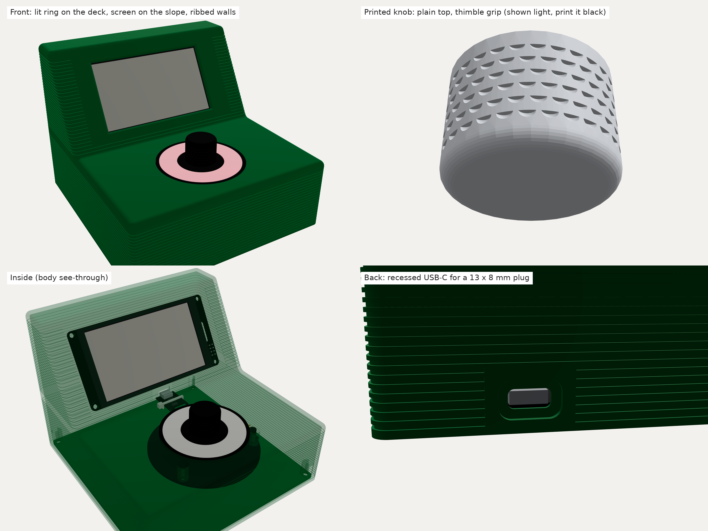
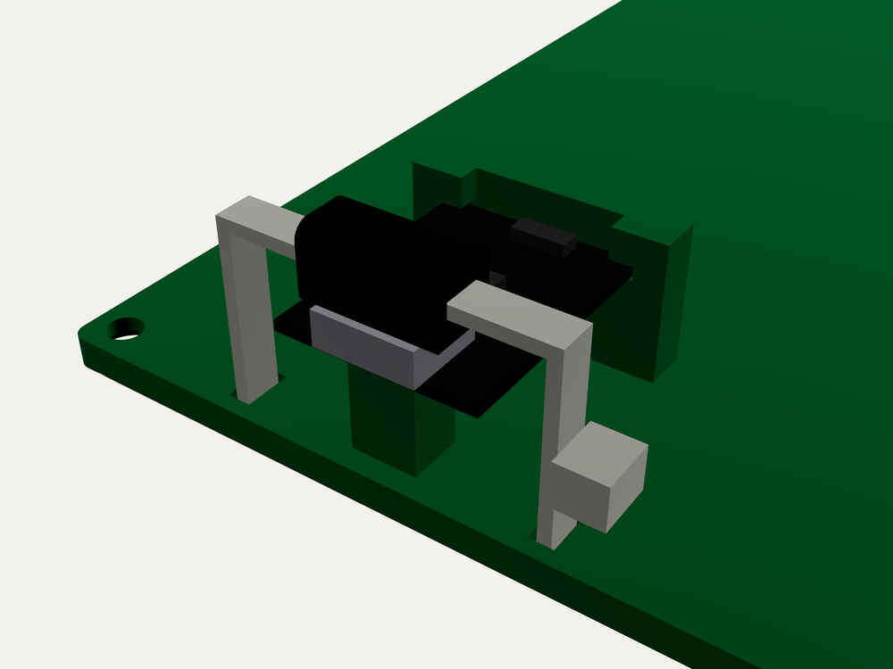

# MessageBox enclosure



A low desk unit, **140 × 145 × 92 mm** (wide × deep × tall). From the side it's a flat front
deck with the knob on top, rising at the back into a block whose sloped face holds the screen.

- **Screen:** the 3.7" e-paper sits landscape on the face, which leans back **30°** from
  vertical so it's easy to read from a chair.
- **Knob:** it stands up out of the deck. Around it, a **white diffuser** ring covers the
  WS2812 ring. A **black light shroud** has a wall outside the diffuser and a disc inside it,
  so the light can't bleed into the **green body**.
- **ESP32-C3:** it sits on a cradle at the back, with its **USB-C reachable through the rear
  wall**. That is also how the box is powered.
- **Vibration motor:** it's screwed under the shroud, so the haptic ticks come up through the
  knob.

| File | What it is |
|---|---|
| `MessageBox-enclosure.step` | The whole assembly with colours: every printed part and every component in place. Opens in Fusion, FreeCAD, Onshape, SolidWorks and others. |
| `print/body.stl` | Green. Prints on its side: the side profile flat on the bed, so every wall stands upright. |
| `print/base.stl` | Green. Prints flat, with the ESP32-C3 cradle and the screw posts facing up. |
| `print/light_shroud.stl` | Black (it must not glow). Prints top-lip down; it needs supports under the flange. |
| `print/esp_clamp.stl` | Any colour (black in the model). A 12 × 6 × 6 mm saddle that locks the ESP32-C3 down with a zip tie through its middle. Prints rounded top down, no supports. |
| `print/diffuser.stl` | White. 2.5 mm flat ring, printed flat. White PLA/PETG at 100 % infill glows evenly. For a softer glow, print it 1.2 mm thick in natural PETG and sand the top. |
| `make_enclosure.py` | Makes all of the above. Every size is a parameter at the top. |
| `check_fit.py` | Builds the model and reports any parts that overlap (there are none). |

## Rebuilding after changing a size

```
pip install cadquery            # CadQuery 2.8
python3 make_enclosure.py       # ~10 s; downloads WeAct's e-paper model the first time
python3 check_fit.py            # optional: reports overlapping parts
```

Things worth changing at the top of the script:

- `SCREEN_TILT`: the screen angle.
- `DECK_H`, `DECK_L`: the deck height and length.
- `W`: the width.
- The colours.
- Your own part sizes.

## Before printing: measure these

The e-paper board, its holes and its connector come from **WeAct's own 3D model and outline
drawing**, so those are exact. Everything else comes from datasheets and listings. Check these
against your parts:

| Part | Assumed | Parameter |
|---|---|---|
| LED ring | 50 mm across, 36 mm hole, 1.6 mm board | `RING_OD`, `RING_ID` |
| Glass border on the ribbon-cable end of the e-paper | 7.0 mm (the other end then has 4.45 mm). If the window shows a strip of border, change this. | `ACTIVE_FPC_BORDER` |
| Encoder module board | 26 mm round; shaft 20 mm from the mounting face | `ENC_SHAFT_L` |
| Knob | 15 mm across, 16 mm tall | `KNOB_D`, `KNOB_H` |
| Vibration board | 25 × 21 mm, two holes 18 mm apart, 7.5 mm below its centre | `VIB_*` |
| ESP32-C3 SuperMini | 22.5 × 18 mm, USB-C sticking out 1 mm | `ESP_*`, `USB_*` |

A quick check: print just the diffuser and the shroud first, and see that they fit the ring
and the knob.

## Hardware

| Qty | Part | For |
|---|---|---|
| 4 | M2.5 × 5 mm self-tapping screws | E-paper board to the bosses inside the screen face |
| 3 | M2.5 × 8 mm self-tapping screws | Light shroud to the bosses under the deck |
| 2 | M2 × 5 mm self-tapping screws | Vibration board to the shroud |
| 4 | M3 × 12 mm countersunk self-tapping screws | Base to the body |
| 4 | 12 mm stick-on rubber feet | Recesses in the base |
| 1 | Zip tie, up to 3.6 mm wide, about 100 mm long | Locks the ESP32-C3 down (through the ESP clamp) |
| | Thin double-sided foam tape (about 0.4 mm) | Between the e-paper glass and the inside of the screen face, round the window |

## Putting it together

1. **Diffuser into the shroud:**
   - Drop the LED ring into the shroud from the top. Its wires go out through the slot in the
     back plate.
   - Press the white diffuser into the top lip. It sits on a step 2.5 mm above the LEDs, and a
     drop of glue holds it.
2. **Encoder:**
   - Push the encoder's threaded bushing up through the shroud's centre hole from underneath.
   - Tighten its nut from the top, inside the black hub.
   - Hang the vibration board under the shroud on its two posts, motor facing down.
3. **Pins:** the deck is low (30 mm), so the encoder module's pins must not point straight
   down with Dupont plugs on them. **Solder wires to the pins, or bend the pins sideways.**
   There's about 3 mm to spare under them.
4. **Shroud into the body:** screw the shroud up under the deck with 3 screws. The black rim,
   white ring and black hub end flush with the deck top. Push the knob on.
5. **E-paper:**
   - Put foam tape round the window inside the screen face.
   - Lay the e-paper glass-first on the tape, and screw the board to the 4 bosses.
   - Its header ends up on the right (seen from the front), next to where the ESP32-C3 sits.
6. **ESP32-C3:**
   - Slide its far end into the slot in the base's cradle, so the USB end rests on the post.
   - Sit the **ESP clamp** on top of the USB-C socket's metal shell.
   - Feed a zip tie up through one slot beside the board, through the tunnel in the middle of
     the clamp, and down the slot on the other side. Lock it under the base: the groove there
     keeps the strap flush, so the base still sits flat.
   - Pull it snug. This squeezes the board between the clamp and the post, while the slot holds
     the far end. The tie passes 5 mm outside the board's edges, so it clears the soldered pins.
     Trim the tail.
   
7. **Close it up:**
   - Wire everything as in [`../wiring.svg`](../wiring.svg).
   - Fit the base into the bottom with the USB-C lined up with the rear-wall hole.
   - Screw the base on and stick on the feet.

**Screen orientation:** the screen is landscape in this box. The firmware now starts in
landscape. If the picture is upside down, choose **Screen orientation → Landscape, flipped** on
the setup page.

## Printing

- **Body:** 0.2 mm layers, 3 walls, 15 % infill. On its side it needs no supports apart from
  the round opening in the deck and the screen window. Both are bridges, which most printers
  manage. Use supports there if yours doesn't.
- **Light shroud:** black, 100 % infill, so no light gets through. It needs supports under the
  flange.
- **Base and diffuser:** no supports.
