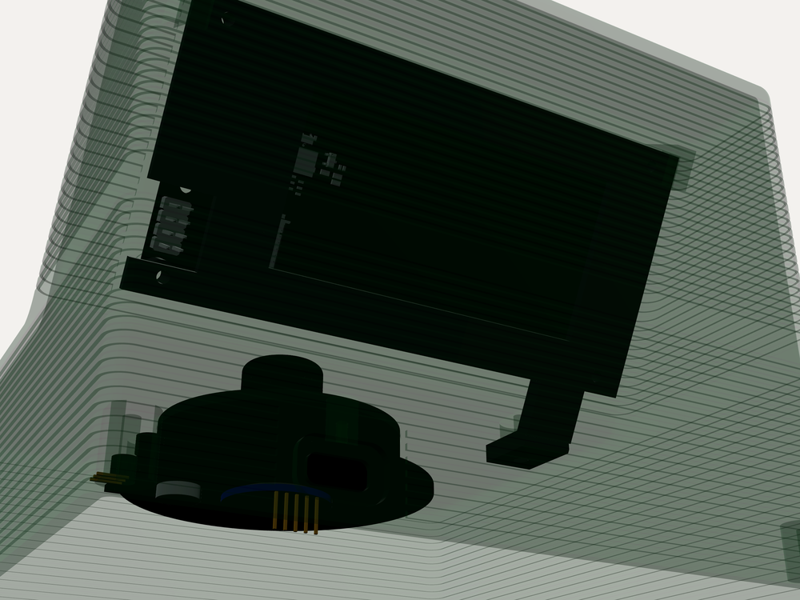

# MessageBox enclosure


A desk unit, **140 × 145 × 111 mm** (wide × deep × tall). From the side it's a flat front deck
with the knob on top, rising at the back into a block whose sloped face holds the screen.

- **Screen:** the 3.7" e-paper sits landscape on the face, which leans back **30°** from
  vertical so it's easy to read from a chair.
- **Knob and ring:** the printed knob stands up out of the deck. Round it, a **0.4 mm white
  diffuser** sits **10 mm above the WS2812 LEDs**, held in a **black light shroud** whose walls
  stop light bleeding into the **green body**.
- **Deck height:** the deck is 48.5 mm tall, so the encoder has **35 mm under its mounting
  face** for its wires.
- **Finish:** the walls are ribbed (1 mm grooves every 2 mm, 0.6 mm deep), running the same way
  as the layer lines, so the 0.2 mm lines disappear into the ribs. The deck top, the top behind
  the screen and a frame round the screen stay smooth.
- **ESP32-C3:** it lies flat on a ridge in the base, held by a 2 mm zip tie, with **20 mm clear
  above it** for wires. Its USB-C sits in a **recessed pocket** in the rear wall that takes a
  13 × 8 mm plug body.
- **Vibration board:** it's screwed flat under the shroud, so the ticks come up through the knob.
  Its wire edge faces into open space, with 20 mm of room.
- **Screen mount:** the e-paper screws to a printed **carrier** on the bench. The carrier slides
  up into rails inside the face and is locked by **one screw from underneath**.
- **Screws:** every screw is the **same small self-tapper** (about 3 mm), in 2.5 mm pilot holes.
  **Every screw can be reached** with an ordinary screwdriver, either straight up through the
  open bottom or on the bench (checked; see below).

| File | What it is |
|---|---|
| `MessageBox-enclosure.step` | The whole assembly with colours: every printed part and every component in place. Opens in Fusion, FreeCAD, Onshape, SolidWorks and others. |
| `print/body.stl` | Green. Prints **upright, open side down**. |
| `print/base.stl` | Green. Prints flat, ridge and posts up. |
| `print/light_shroud.stl` | Black. Prints flange-down. |
| `print/diffuser.stl` | White. A 0.4 mm flat ring. |
| `print/screen_carrier.stl` | Any colour (hidden). Holds the e-paper. Prints flat on its back, no supports. |
| `print/knob.stl` | Black. A 20 mm knob with a plain top and thimble dimples round the side. Prints top-down. |
| `make_enclosure.py` | Makes all of the above. Every size is a parameter at the top. |
| `print_check.py` | The print-readiness check below. |
| `ring-section.png`, `section_drawing.py` | A cut through the knob: diffuser, 10 mm air gap, LED ring, encoder. |

## Print-readiness check

`python3 print_check.py` rebuilds the model and checks everything below. It currently passes
every check.

| Check | Result |
|---|---|
| Printed parts | Body, base, shroud, diffuser and knob: each one valid solid |
| Overlaps | No two parts overlap (all components included) |
| Encoder | 35.3 mm from its mounting face to the base; the column under its board is empty |
| ESP32-C3 | 20 mm clear above the whole board |
| Vibration board | 20 mm clear off its wire edge |
| LED ring | Its wired pins drop through a 50° slot in the channel floor, with 15 mm clear below |
| E-paper header | 25 mm clear behind it |
| USB-C | 13 × 8 plug body in a 14.5 × 9 pocket; the socket sits 1.3 mm behind it, so any cable reaches |
| Diffuser | 0.3 mm gap each side; rests on 0.7 mm ledges at both edges |
| Shroud in the deck | 0.3 mm gap; screen carrier in its rails 0.35 mm; base in the body 0.4 mm |
| Knob | 0.5 mm above the deck, 5 mm clear of the diffuser; covers the nut pocket |
| Nut pocket | 15.5 mm, so a 10 mm socket fits |
| Encoder plate | Has a groove for the anti-rotation tab, so the encoder sits flat |
| Thinnest walls | 1.9 mm under the ribs; 1.0 mm at the USB pocket; 1.8 mm base under the zip-tie groove |
| Screen screw-head pockets | Leave 1.5 mm of face wall; the carrier clears the board's parts by 0.9 mm |
| Tool access | Shroud screws (3) and the screen-lock screw go straight up from the open bottom with nothing in the way. A 10 mm socket reaches the encoder nut from above. |
| Screen slide-in | The screen and carrier clear everything at every millimetre of their 8 mm slide |
| STL files | Watertight, and fit a 220 × 220 × 250 mm bed |

## Tolerances (built into the STLs)

The STLs are drawn for a normal FDM printer (0.4 mm nozzle, PLA or PETG, 0.2 mm layers), so
the sizes below are what fits **after** printing. Every value is a parameter at the top of
`make_enclosure.py`.

| Fit | Gap per side, as drawn | Parameter |
|---|---|---|
| Light shroud into the deck opening | 0.30 mm | `FIT_SLIDE` |
| Diffuser between the shroud lip and the hub | 0.30 mm | `FIT_SLIDE` |
| Screen carrier in its rails (sides, behind, top stop) | 0.35 mm | `FIT_RAIL` |
| Base inside the body | 0.40 mm, plus a 0.5 mm chamfer round its underside | `FIT_BASE`, `EF_CHAMFER` |
| ESP32-C3 against its stop | 0.3 mm play | |
| Zip-tie slots (for a 2 × 1 mm tie) | 0.4 mm | |
| USB-C plug body (13 × 8) in its pocket | 0.75 / 0.5 mm | `USB_POCKET_*` |

**Holes:** printed holes come out about 0.15 mm small, so every hole is drawn 0.15 mm bigger
(`HOLE_COMP`):

| Hole | Drawn | Prints at about |
|---|---|---|
| Self-tapper pilot (all screws) | 2.65 mm | 2.5 mm |
| Screw clearance | 3.45 mm | 3.3 mm |
| Encoder bushing | 7.35 mm | 7.2 mm (7 mm bushing) |
| Knob bore | 6.0 mm | 5.85 mm: a press fit on the 6 mm knurled shaft |

**Elephant's foot:** the base's underside has a 0.5 mm chamfer, so the first layers can't
stop it going into the body. Slicer elephant-foot compensation (about 0.15 mm) is still worth
turning on for the body, the base and the screen carrier.

**Slicer settings:** keep **X-Y hole compensation and X-Y size compensation at 0**, because
the files already allow for them. If your printer prints holes true to size (some tuned
printers do), set `HOLE_COMP = 0` and rebuild.

**Test fit first:** print the knob, diffuser and shroud (about 1.5 hours together) and check
them on the encoder and the LED ring before the long body print. If the knob is loose, lower
`KNOB_BORE` by 0.1 mm; if a slide fit is tight, raise `FIT_SLIDE` by 0.1.

## Printing

| Part | Colour | Orientation | Settings | Supports |
|---|---|---|---|---|
| Body | Green | Upright, open side down (as exported) | 0.2 mm layers, 3 walls, 15 % infill | **Tree supports, from the build plate and on the model.** They only form inside: under the deck roof, the roof behind the screen, the screen window's top edge, the four corner posts and the screw bosses. The outside needs none. |
| Base | Green | Flat, ridge and posts up | 0.2 mm, 3 walls, 20 % | None. The zip-tie groove and foot recesses underneath are short bridges. |
| Light shroud | **Black** | Flange down | 0.2 mm, **100 % infill** so no light gets through | None. The encoder plate over the hub is a 20 mm round bridge. |
| Diffuser | White PLA/PETG | Flat | 0.2 mm (exactly two layers), 100 %, concentric top pattern | None |
| Screen carrier | Any | Flat on its back (as exported) | 0.2 mm, 3 walls, 20 % | None |
| Knob | Black | Top down (as exported) | 0.12–0.16 mm layers for crisp dimples, 100 % | None. Use a brim if it wobbles. |

Notes:

- **Body texture:** printed upright, the grooves line up with the layers. Each groove is just a
  few layers printed 0.6 mm further in, a step that needs no support.
- **Diffuser:** if you can still see the LEDs as dots, set `DIFF_T = 0.6`. If it's too dim, use
  natural (translucent) PETG.
- **Knob fit:** its hole prints at about 5.85 mm and presses onto the KY-040's knurled split
  shaft. For a D-shaft encoder, set `KNOB_BORE = 6.25` and add a drop of glue.

## The diffuser: why 10 mm


The 12 LEDs are 11.3 mm apart round the ring. A 0.4 mm diffuser is thin and lets a lot of light
straight through, so it shows the LEDs as dots unless their light has spread before it gets
there. Modelling each WS2812B as a wide-angle (120°) emitter:

| LED tops to diffuser | Darkest point between two LEDs, compared with over one | Inner / outer edge of the ring |
|---|---|---|
| 2.5 mm | 5 % (12 separate dots) | 10 % |
| 6 mm | 54 % | 58 % / 47 % |
| 8 mm | 78 % | 75 % / 60 % |
| **10 mm** | **91 %: a smooth band** | **86 % / 69 %** |
| 12 mm | 96 % | 93 % / 75 % |

Above about 90 % the eye sees one continuous ring. At 10 mm it's about a third as bright as at
3 mm, which doesn't matter: the LEDs run at 60 of 255. `DIFF_GAP` and `DIFF_T` change it.

## Before printing: measure these

The e-paper board, its holes and its header come from **WeAct's own 3D model and drawing**, so
those are exact. Everything else is from datasheets and listings:

| Part | Assumed | Parameter |
|---|---|---|
| LED ring | 50 mm across, 36 mm hole, 1.6 mm board | `RING_OD`, `RING_ID` |
| Glass border on the ribbon end of the e-paper | 7.0 mm (4.45 mm at the other end). If the window shows a strip of border, change it. | `ACTIVE_FPC_BORDER` |
| Encoder module | 26 mm round board; shaft 20 mm from the mounting face, knurled 6 mm | `ENC_SHAFT_L`, `KNOB_BORE` |
| Vibration board | 21 × 25 mm, two holes 18 mm apart on the wire edge | `VIB_*` |
| ESP32-C3 SuperMini | 22.5 × 18 mm; USB-C sticking out 1 mm | `ESP_*`, `USB_*` |


## Hardware and tools

| Qty | Part | For |
|---|---|---|
| 4 | Small self-tapper, 8 mm, **pan head no taller than 2.5 mm** | E-paper to the carrier (heads sit in pockets in the face) |
| 1 | Small self-tapper, 10 mm | Locks the screen carrier (from underneath) |
| 3 | Small self-tapper, 8 mm | Light shroud (from underneath) |
| 2 | Small self-tapper, 6–8 mm | Vibration board to the shroud (on the bench) |
| 4 | Small self-tapper, 12 mm, countersunk | Base |
| 4 | 12 mm stick-on rubber feet | Base |
| 1 | 2 mm zip tie, about 100 mm | ESP32-C3 |
| | Thin double-sided foam tape (about 0.4 mm) | Round the window, between the glass and the face |

All screws take the same 2.5 mm pilot hole as printed (about 3 mm self-tappers).

**Tools:**
- A small Phillips or Pozi screwdriver with a shaft **at least 60 mm long**, because the shroud
  and screen-lock screws sit 33–41 mm up inside the open bottom.
- A **10 mm socket** (14 mm across at most) for the encoder nut.
- A soldering iron, and flush cutters for the zip tie.

## Putting it together

Work through the open bottom, with the body upside down on a soft cloth. The order matters:
each step leaves a straight path for the next screw.

1. **Light shroud (bench):**
   - Drop the LED ring into the shroud's channel, LEDs up. Turn it so its wired pins drop through
     the arc slot behind the knob.
   - Lay the 0.4 mm diffuser on top. It rests on a step on the outer wall and one on the black
     hub. A thin bead of clear glue round its outer edge holds it.
2. **Encoder (bench):** push its bushing up through the shroud's centre hole from underneath, tab
   in its groove, and tighten the nut from the top with the 10 mm socket.
3. **Vibration board (bench):** screw it flat under the shroud's flange (2 screws), wire edge
   facing right as seen from the front.
4. **Shroud into the body:** put it up into the deck opening from inside. Drive its 3 screws
   straight up through the open bottom. The black rim, white ring and black hub end flush with
   the deck.
5. **Screen (bench, then in):**
   
   - Solder the screen's jumper wires.
   - Lay the module glass-down. Put the carrier on its back, bosses to the board, and drive the 4
     screws **from the front** (glass side) through the board's corner holes into the carrier.
   - Put foam tape round the window inside the face.
   - From inside, hold the screen against the face about 8 mm below its final place, with the
     carrier's edges lined up with the two short rails near the top. Slide it up the slope into
     the rails until it stops.
   - Drive the locking screw straight up from underneath, through the carrier's arm (at the left,
     seen from the front) into the boss under the deck. Tightening it presses the screen
     against the window.
6. **ESP32-C3 (on the base, bench):**
   - Solder its jumper wires.
   - Lay it flat on the ridge, far end against the stop.
   - Feed the 2 mm zip tie up one slot, over the **GPIO3 and GPIO9 pads**, down the other slot,
     and lock it in the groove underneath.
   
7. **Close it up:**
   - Join the wires as in [`../wiring.svg`](../wiring.svg).
   - Fit the base with the USB-C in its rear pocket and drive the 4 countersunk screws.
   - Stick on the feet, and press the knob onto the shaft.

**Screen orientation:** if the picture is upside down, choose **Screen orientation → Landscape,
flipped** on the setup page.

## Rebuilding after changing a size

```
pip install cadquery trimesh    # CadQuery 2.8
python3 make_enclosure.py       # ~30 s; downloads WeAct's e-paper model the first time
python3 print_check.py          # ~1 min
```
