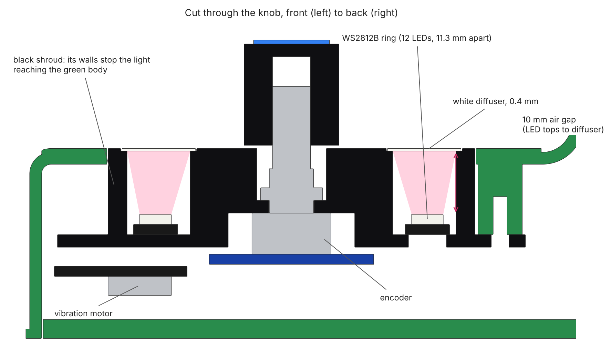

# MessageBox enclosure


A low desk unit, **140 × 145 × 92 mm** (wide × deep × tall). From the side it's a flat front
deck with the knob on top, rising at the back into a block whose sloped face holds the screen.

- **Screen:** the 3.7" e-paper sits landscape on the face, which leans back **30°** from
  vertical so it's easy to read from a chair.
- **Knob:** it stands up out of the deck. Around it, a **0.4 mm white diffuser** ring sits
  **10 mm above the WS2812 LEDs** (see below for why). A **black light shroud** holds the
  diffuser and has walls outside it and a disc inside it, so the light can't bleed into the
  **green body**.
- **Finish:** the body has a **fluted texture**: 1 mm grooves every 2 mm, 0.6 mm deep, running
  the same way as the layer lines, so the 0.2 mm layer lines disappear into deliberate ribs.
  Smooth frames surround the screen, the ring and the USB-C hole.
- **ESP32-C3:** it sits on a cradle at the back, with its **USB-C reachable through the rear
  wall**. That is also how the box is powered.
- **Vibration motor:** it's screwed under the shroud, so the haptic ticks come up through the
  knob.

| File | What it is |
|---|---|
| `MessageBox-enclosure.step` | The whole assembly with colours: every printed part and every component in place. Opens in Fusion, FreeCAD, Onshape, SolidWorks and others. |
| `print/body.stl` | Green. Prints on its side: the side profile flat on the bed, so every wall stands upright. |
| `print/base.stl` | Green. Prints flat, with the ESP32-C3 cradle and the screw posts facing up. |
| `print/light_shroud.stl` | Black (it must not glow). Prints top-lip down; it needs supports under the flange. |
| `print/diffuser.stl` | White. A 0.4 mm flat ring: two 0.2 mm layers, printed flat. |
| `make_enclosure.py` | Makes all of the above. Every size is a parameter at the top. |
| `check_fit.py` | Builds the model and reports any parts that overlap (there are none). |
| `ring-section.png`, `section_drawing.py` | A cut through the knob showing the diffuser, the 10 mm air gap and the LED ring. |

## The diffuser: why 10 mm



The 12 LEDs are 11.3 mm apart round the ring. A 0.4 mm diffuser is thin and lets a lot of light
straight through, so it shows the LEDs as dots unless their light has spread before it gets
there. I modelled each WS2812B as a wide-angle (120°) emitter and worked out how evenly they
light the diffuser at different gaps:

| LED tops to diffuser | Darkest point between two LEDs, compared with over one | Inner / outer edge of the ring |
|---|---|---|
| 2.5 mm | 5 % (12 separate dots) | 10 % |
| 6 mm | 54 % | 58 % / 47 % |
| 8 mm | 78 % | 75 % / 60 % |
| **10 mm** | **91 %: a smooth band** | **86 % / 69 %** |
| 12 mm | 96 % | 93 % / 75 % |

Above about 90 % the eye sees one continuous ring, and the diffuser's own scattering evens it
out a little more. 10 mm is also about as deep as the 30 mm deck allows with the vibration motor
underneath. Moving the LEDs further away makes the ring dimmer: at 10 mm it's about a third as
bright as at 3 mm. That doesn't matter here, because the LEDs run at 60 of 255 by default.
`DIFF_GAP` and `DIFF_T` in the script change it.

## Rebuilding after changing a size

```
pip install cadquery            # CadQuery 2.8
python3 make_enclosure.py       # ~10 s; downloads WeAct's e-paper model the first time
python3 check_fit.py            # optional: reports overlapping parts
```

Things worth changing at the top of the script:

- `SCREEN_TILT`: the screen angle.
- `DECK_H`, `DECK_L`: the deck height and length.
- `W`: the width.
- The colours.
- Your own part sizes.

## Before printing: measure these

The e-paper board, its holes and its connector come from **WeAct's own 3D model and outline
drawing**, so those are exact. Everything else comes from datasheets and listings. Check these
against your parts:

| Part | Assumed | Parameter |
|---|---|---|
| LED ring | 50 mm across, 36 mm hole, 1.6 mm board | `RING_OD`, `RING_ID` |
| Glass border on the ribbon-cable end of the e-paper | 7.0 mm (the other end then has 4.45 mm). If the window shows a strip of border, change this. | `ACTIVE_FPC_BORDER` |
| Encoder module board | 26 mm round; shaft 20 mm from the mounting face | `ENC_SHAFT_L` |
| Knob | 15 mm across, 16 mm tall | `KNOB_D`, `KNOB_H` |
| Vibration board | 25 × 21 mm, two holes 18 mm apart, 7.5 mm below its centre | `VIB_*` |
| ESP32-C3 SuperMini | 22.5 × 18 mm, USB-C sticking out 1 mm; pin rows 15.24 mm apart | `ESP_*`, `USB_*`, `PIN_ROW_DX` |

A quick check: print just the diffuser and the shroud first, and see that they fit the ring
and the knob.

## Hardware

| Qty | Part | For |
|---|---|---|
| 4 | M2.5 × 5 mm self-tapping screws | E-paper board to the bosses inside the screen face |
| 3 | M2.5 × 8 mm self-tapping screws | Light shroud to the bosses under the deck |
| 2 | M2 × 5 mm self-tapping screws | Vibration board to the shroud |
| 4 | M3 × 12 mm countersunk self-tapping screws | Base to the body |
| 4 | 12 mm stick-on rubber feet | Recesses in the base |
| 1 | 2 mm zip tie, about 100 mm long | Holds the ESP32-C3 down, round the middle of the board |
| | Thin double-sided foam tape (about 0.4 mm) | Between the e-paper glass and the inside of the screen face, round the window |

## Putting it together

1. **Diffuser into the shroud:**
   - Drop the LED ring into the shroud's channel from the top, LEDs facing up. Its wires go out
     through the slot in the channel floor.
   - Lay the 0.4 mm diffuser into the top. It rests on a step on the outer wall and one on the
     black hub, 10 mm above the LEDs. A thin bead of clear glue round the outer edge holds it.
2. **Encoder:**
   - Push the encoder's threaded bushing up through the shroud's centre hole from underneath.
   - Tighten its nut from the top, inside the black hub.
   - Hang the vibration board under the shroud on its two posts, motor facing down.
3. **Pins:** the deck is low (30 mm), so the encoder module's pins must not point straight
   down with Dupont plugs on them. **Solder wires to the pins, or bend the pins sideways.**
   There's about 3 mm to spare under them.
4. **Shroud into the body:** screw the shroud up under the deck with 3 screws. The black rim,
   white ring and black hub end flush with the deck top. Push the knob on.
5. **E-paper:**
   - Put foam tape round the window inside the screen face.
   - Lay the e-paper glass-first on the tape, and screw the board to the 4 bosses.
   - Its header ends up on the right (seen from the front), next to where the ESP32-C3 sits.
6. **ESP32-C3:**
   - Solder the jumper wires straight to the pins you use; there's no need for header pins.
     **Leave the middle two pins on each side free:** GPIO4 and GPIO3 on one side, GPIO8 and
     GPIO9 on the other. The firmware doesn't use them.
   - Lay the board flat on the ridge in the base, with the USB-C in the rear-wall hole and the
     far end against the stop. The ridge keeps the solder joints underneath off the base.
   - Feed a 2 mm zip tie up through the slot beside one edge of the board, over the middle of the
     board (between the free pins), and down the slot by the other edge. Lock it under the base:
     the groove there keeps the strap flush, so the base still sits flat. Pull it snug and trim
     the tail.
   
7. **Close it up:**
   - Wire everything as in [`../wiring.svg`](../wiring.svg).
   - Fit the base into the bottom with the USB-C lined up with the rear-wall hole.
   - Screw the base on and stick on the feet.

**Screen orientation:** the screen is landscape in this box. The firmware now starts in
landscape. If the picture is upside down, choose **Screen orientation → Landscape, flipped** on
the setup page.

## Printing

- **Body:** 0.2 mm layers, 3 walls, 15 % infill, printed on its side as exported.
  - **Texture:** the flutes then line up with the layers, so each groove is just a few layers
    printed 0.6 mm further in. There are no overhangs and nothing to support.
  - **Supports:** only the round opening in the deck and the screen window may need them. Both
    are bridges, which most printers manage; use supports there if yours doesn't.
  - **Side faces:** the side on the bed takes the bed's finish, so a textured PEI sheet gives it
    a matching matte look. Ironing tidies the top side.
- **Light shroud:** black, 100 % infill, so no light gets through. Print it top-lip down. Slicer
  supports are needed under the flange, and the channel floor may need them too.
- **Diffuser:** white PLA or PETG, 0.2 mm layers (exactly two), 100 % infill, no supports.
  - Use a concentric top pattern so its lines follow the ring.
  - If you can still see dots, make it 0.6 mm thick (`DIFF_T = 0.6`). If it's too dim, use
    natural (translucent) PETG instead of white.
- **Base:** no supports.
